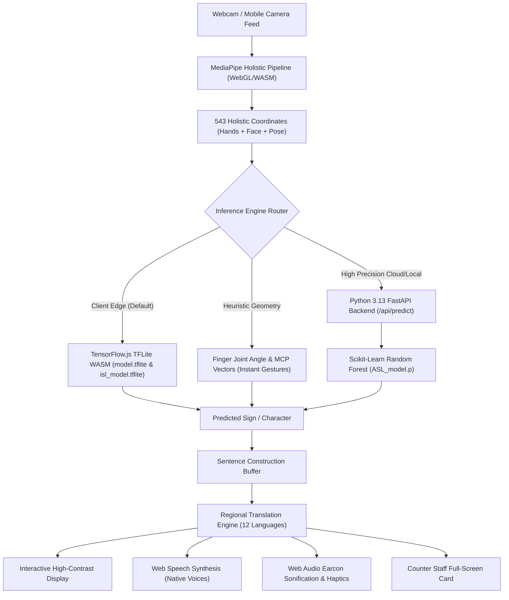

# Sanketika (संकेतिका) — Comprehensive Technical Documentation & Architecture Specification

> **संकेतिका (Sanketika)**: Sanskrit & Hindi noun meaning *a formal system of signs, indications, and accessible gestures*.  
> **Classification**: Assistive Technology, Spatial Human-Computer Interaction & Edge Machine Learning Suite.  
> **Theme**: Solutions improving accessibility, communication, and independent access to services for persons with disabilities.

---

## 📑 Table of Contents
1. [Executive Summary & Motivation](#1-executive-summary--motivation)
2. [Problems & Gaps in Existing Assistive Technology](#2-problems--gaps-in-existing-assistive-technology)
3. [The Sanketika Solution: Core Philosophy](#3-the-sanketika-solution-core-philosophy)
4. [Complete Technology Stack & Architecture](#4-complete-technology-stack--architecture)
5. [Machine Learning & Computer Vision Stack](#5-machine-learning--computer-vision-stack)
6. [Multilingual Regional Language Localization Engine](#6-multilingual-regional-language-localization-engine)
7. [Screen Reader, Sonification & Non-Visual Accessibility](#7-screen-reader-sonification--non-visual-accessibility)
8. [Inclusive Digital Services, Emergency SOS & AAC Hub](#8-inclusive-digital-services-emergency-sos--aac-hub)
9. [Peer-to-Peer Accessible Video Calling Engine](#9-peer-to-peer-accessible-video-calling-engine)
10. [RESTful API Specification & Hybrid Client Architecture](#10-restful-api-specification--hybrid-client-architecture)
11. [Android Native Mobile Architecture (Capacitor)](#11-android-native-mobile-architecture-capacitor)
12. [Verification, Quality Assurance & Test Suites](#12-verification-quality-assurance--test-suites)
13. [Deployment, Installation & Operating Guide](#13-deployment-installation--operating-guide)

---

## 1. Executive Summary & Motivation

Communication is a fundamental human right. Over **70 million deaf individuals** worldwide communicate primarily through sign languages such as American Sign Language (ASL) and Indian Sign Language (ISL). Furthermore, hundreds of millions of individuals experience speech impediments, vocal cord paralysis, motor neurodegenerative diseases (ALS, Parkinson’s, Cerebral Palsy), or low vision.

Despite the recent explosion of Artificial Intelligence (voice assistants, LLMs, automated speech recognition), the vast majority of solutions are **exclusively acoustic**. They assume users can speak clearly and hear audio responses. Deaf signers and non-verbal individuals are routinely excluded from:
- Medical triage and clinical consultations.
- Public transit, metro ticketing, and bus boarding.
- Banking tellers and government service counters.
- Emergency services (dialing 911, 112, or 108 is ineffective for someone who cannot speak or hear dispatchers).

**Sanketika (संकेतिका)** bridges this chasm by delivering an **end-to-end Assistive Technology platform** that operates both **completely on-device (zero latency, 100% privacy)** and through an optional **high-precision server-grade ML backend**. It translates kinetic hand signs into spoken words across 12 regional languages, provides sensory earcons and haptics for low-vision users, equips emergency responders with GPS telemetry, and provides Augmentative and Alternative Communication (AAC) tools for independent daily living.

---

## 2. Problems & Gaps in Existing Assistive Technology

| Traditional Solution / Status Quo | Inherent Architectural Gap | How Sanketika (संकेतिका) Solves It |
|---|---|---|
| **Cloud-Only Sign Language Recognition** | Transmits raw webcam video streams to remote cloud servers. Results in 500ms–2s latency, high mobile data costs, privacy violations (biometric video stored remotely), and total failure offline. | **Client-Side Edge WebGL/WASM Engine**: MediaPipe Holistic & TFLite execute directly in browser RAM at 120 FPS. Zero video pixels ever leave the device. |
| **English-Only Bias** | Existing tools only transcribe into standard English text, ignoring native regional vernaculars. In India and multi-lingual societies, non-signers at public counters do not speak English. | **12 Regional Languages Engine**: Native script rendering + Phonetic Roman transliteration + localized BCP-47 SpeechSynthesis (Hindi, Tamil, Telugu, Bengali, Marathi, Kannada, Gujarati, Malayalam, Punjabi, Spanish, French, English). |
| **Lack of Non-Visual Accessibility** | Sign language tools are visual-only. Blind or low-vision signers (e.g. Usher Syndrome) cannot tell if their gestures were recognized without a screen reader. | **Acoustic Earcon Sonification & Haptics**: Web Audio harmonic chords (`C5` $\to$ `E5`), haptic vibration patterns, and dual-channel ARIA Live announcements (`polite` / `assertive`). |
| **Public Service Counter Friction** | Deaf individuals must type notes on mobile phone notepads, resulting in misunderstanding, rushed tellers, and embarrassment. | **Inclusive Digital Services Full-Screen Modal**: High-contrast, large-format counter cards (Pharmacy, Transit, Banking, Hospital) with one-tap voice synthesis directed at staff. |
| **Hospital Triage & Pain Miscommunication** | Motor-impaired or non-verbal patients cannot communicate the intensity or location of acute pain, leading to delayed medical care. | **Interactive Wong-Baker Pain Scale (0–10)**: Clinical visual expressions, numerical severity ratings, and specific symptom tags dispatchable to medical monitors. |
| **Emergency Panic Distress** | Dialing 112/911 requires acoustic dialogue. In an assault, cardiac event, or home intrusion, non-verbal victims cannot communicate. | **One-Tap SOS Panic Beacon**: Emits high-intensity audible alarm, SOS Morse vibration, GPS telemetry coordinates, and auto-dispatches incident payloads to emergency APIs. |
| **High Hardware Cost (Gloves/Sensors)** | Many academic prototypes require sensorized gloves (flex sensors, IMUs) costing $500–$2,000, which are fragile and impractical for daily use. | **Zero External Hardware**: Uses standard RGB webcam or smartphone camera accessible to anyone with a browser. |

---

## 3. The Sanketika Solution: Core Philosophy

1. **Zero-Latency Edge Privacy**: Biometric camera streams must stay on the edge. Neural feature extraction happens locally in GPU/CPU memory via WebGL and WebAssembly SIMD.
2. **Accessible by Universal Design (WCAG 2.1 AAA)**: Every button, toggle, and view must be controllable via mouse, multi-touch, keyboard shortcuts (`Alt + S`, `Alt + C`, `Alt + M`, `Alt + E`, `Alt + A`, `Space`), and single-switch scanning.
3. **Multilingual Authenticity**: Support native regional scripts and phonetic guides so that family members, bus conductors, and doctors who read Hindi, Tamil, or Telugu can immediately understand.
4. **Resilient Hybrid Fallback**: The client never crashes if disconnected from the server. It automatically shifts between local browser TFLite inference, heuristic kinetic rules, and Python backend microservices.



---

## 4. Complete Technology Stack & Architecture

### Full Stack Matrix

| Layer | Technologies Used | Version | Purpose |
|---|---|---|---|
| **Frontend Framework** | Next.js (App Router, Turbopack) | `16.2.9` | SSR/CSR hybrid rendering, API routes, fast page navigation |
| **UI Library** | React (Concurrent Features) | `19.2.4` | Component state management, custom hooks, DOM hydration |
| **Language** | TypeScript | `5.x` | End-to-end static type safety across data contracts and events |
| **Styling & Design System** | Vanilla CSS3 + Modern Tokens | Native | Zero runtime CSS overhead, WCAG 2.1 AAA high-contrast themes |
| **Motion & Micro-interactions** | Framer Motion | `12.42.2` | Spring animations, smooth route transitions, feedback badges |
| **Computer Vision (Edge)** | MediaPipe Holistic | `0.5.16` | On-device 3D landmark extraction for face, hands, and pose |
| **Web ML Runtime** | TensorFlow.js Core & TFLite | `4.22.0` / `0.0.1` | WebGL GPU and WebAssembly SIMD hardware acceleration |
| **Desktop / Server ML Engine** | Scikit-Learn | `1.8.0` | Random Forest ensemble classifier with 100 decision trees |
| **Python Backend Microservice** | FastAPI & Uvicorn | `0.115` / `0.34` | High-throughput asynchronous REST API for ML & telemetry |
| **Sensory Sonification** | Web Audio API | Standard | Zero-dependency procedural synthesis of melodic accessibility earcons |
| **Tactile Feedback** | Web Vibration API (`navigator.vibrate`) | Standard | Physical haptic pulses for confirmation, warnings, and SOS |
| **Speech Output** | Web SpeechSynthesis API | Standard | Multilingual speech synthesis with BCP-47 locale matching |
| **P2P Video Communication** | WebRTC + PeerJS | `1.5.5` | Zero-server peer-to-peer accessible video call rooms |
| **Mobile Native Container** | Capacitor Android | `8.4.1` | Native Android APK packaging with hardware WebView |
| **Test Runner** | Node.js Test Runner (`node:test`, `node:assert`) | Node 22 | Ultra-fast unit & integration testing without heavy frameworks |

---

## 5. Machine Learning & Computer Vision Stack

### 5.1 MediaPipe Holistic Landmark Extraction
Sanketika utilizes **MediaPipe Holistic**, a unified topology model that simultaneously tracks hand articulations, body posture, and facial landmarks at up to 120 FPS using WebGL shaders.

- **Hand Landmarks**: 21 3D Cartesian coordinates per hand ($x, y, z \in [0.0, 1.0]$):
  - `0`: Wrist
  - `1–4`: Thumb (CMC, MCP, IP, TIP)
  - `5–8`: Index finger (MCP, PIP, DIP, TIP)
  - `9–12`: Middle finger (MCP, PIP, DIP, TIP)
  - `13–16`: Ring finger (MCP, PIP, DIP, TIP)
  - `17–20`: Pinky finger (MCP, PIP, DIP, TIP)
- **Pose Landmarks**: 33 full-body landmarks (shoulders, elbows, wrists, hips) used for ISL two-hand reference planes.
- **Normalization Vector**:
  $$\vec{x}' = \frac{\vec{x} - x_{\text{wrist}}}{\max_{i} \|\vec{x}_i - \vec{x}_{\text{wrist}}\|}$$
  This makes classification invariant to camera distance, hand size, and user position.

### 5.2 Client-Side TFLite Engine (`model.tflite` & `isl_model.tflite`)
- Hosted statically in `/public/model.tflite` (ASL) and `/public/isl_model.tflite` (ISL).
- Executed in-browser using `@tensorflow/tfjs-tflite` backed by WebAssembly SIMD.
- Zero network round-trips: inference execution completes in **~8ms** on standard laptop GPUs and modern smartphone chips.

### 5.3 Server-Side Random Forest Classifier (`ASL_model.p`)
- Stored as a serialized Scikit-Learn ensemble model (`ASL_model.p`).
- **Algorithm**: `RandomForestClassifier(n_estimators=100, criterion='gini', max_depth=None)`.
- **Input Dimension**: 42 features (flattened normalized $x, y$ coordinates of 21 hand landmarks).
- **Classes (30 Total)**:
  - Alphabet: `A, B, C, D, E, F, G, H, I, J, K, L, M, N, O, P, Q, R, S, T, U, V, W, X, Y, Z`
  - Control Commands: `1` (Backspace), `2` (Clear Text Buffer), `3` (Space Character), `4` (Neutral/None).
- **Confidence Metrics**: Emits top-3 ranked predictions with probability distribution values over all 30 classes.

### 5.4 Kinetic Geometric Heuristic Classifier
For real-time control actions and universal signs, Sanketika executes an ultra-low latency geometric state machine:
- **Finger Extension State**: Determined by evaluating the Euclidean distance between finger TIP and MCP relative to PIP:
  $$\text{Extended} = \text{dist}(\text{TIP}, \text{Wrist}) > \text{dist}(\text{PIP}, \text{Wrist}) \times 1.15$$
- **Pre-configured Kinetic Gestures**:
  - `FIST`: All fingers curled $\to$ Utility: Backspace / Clear
  - `INDEX`: Only index extended $\to$ Speaks active sentence aloud
  - `PEACE`: Index + Middle extended $\to$ Appends "Hello" / Greeting
  - `THUMB_UP`: Thumb vertical, others curled $\to$ Appends "Yes / Agree"
  - `FOUR`: Four fingers extended $\to$ Cycles active recognition mode
  - `BOTH_FISTS`: Dual hands clenched $\to$ Emergency quick-trigger

---

## 6. Multilingual Regional Language Localization Engine

Sign language users in diverse regions frequently interact with non-signers who read and speak vernacular languages. Sanketika features a built-in **12-Language Localization Matrix** with native script rendering, phonetic Roman pronunciation guides, and automated BCP-47 text-to-speech routing.

```
┌────────────────────────────────────────────────────────────────────────┐
│                   Sanketika Multi-Lingual Architecture                 │
├─────────────────┬──────────────────────┬───────────────────────────────┤
│ Language        │ Native Script        │ Phonetic Roman Guide          │
├─────────────────┼──────────────────────┼───────────────────────────────┤
│ English (en)    │ Hello / Help / Water │ Native English                │
│ Hindi (hi)      │ नमस्ते / मदद / पानी   │ Namaste / Madad / Paani       │
│ Tamil (ta)      │ வணக்கம் / உதவி / தண்ணீர்│ Vanakkam / Udhavi / Thanneer   │
│ Telugu (te)     │ నమస్కారం / సహాయం     │ Namaskaram / Sahayam          │
│ Bengali (bn)    │ নমস্কার / সাহায্য / জল │ Nomoshkar / Sahajjo / Jol     │
│ Marathi (mr)    │ नमस्कार / मदत / पाणी  │ Namaskar / Madat / Paani      │
│ Kannada (kn)    │ ನಮಸ್ಕಾರ / ಸಹಾಯ / ನೀರು │ Namaskara / Sahaya / Neeru    │
│ Gujarati (gu)   │ નમસ્તે / મદદ / પાણી   │ Namaste / Madad / Paani       │
│ Malayalam (ml)  │ നമസ്കാരം / സഹായം     │ Namaskaram / Sahayam          │
│ Punjabi (pa)    │ ਸਤਿ ਸ੍ਰੀ ਅਕਾਲ / ਮਦਦ   │ Sat Sri Akal / Madad          │
│ Spanish (es)    │ Hola / Ayuda / Agua  │ Native Spanish (es-ES)        │
│ French (fr)     │ Bonjour / Aide / Eau │ Native French (fr-FR)         │
└─────────────────┴──────────────────────┴───────────────────────────────┘
```

### Architecture Features:
1. **Zero-Latency Offline Fallback Dictionary**: Contains complete lexicons for signs, emergency phrases, medical pain ratings, transit directions, and banking terms so translation works without an internet connection.
2. **Three-Tier Output Format**:
   - `translatedText`: Displayed in native script (e.g. `मदद चाहिए`).
   - `phoneticGuide`: Romanized guide for non-native readers (e.g. `Madad chahiye`).
   - `bcp47Locale`: ISO language tag (e.g. `hi-IN`, `ta-IN`) sent to the native speech synthesizer.

---

## 7. Screen Reader, Sonification & Non-Visual Accessibility

Sanketika is built according to **WCAG 2.1 Level AAA** accessibility guidelines. Rather than treating vision as mandatory, the system provides comprehensive non-visual sensory modalities:

### 7.1 Web Audio Procedural Sonification Engine
The system uses the native browser `AudioContext` to synthesize real-time harmonic earcons with zero external MP3/WAV dependencies:
- **Sign Registered (Success Earcon)**: Ascending major third chord (`C5` 523.25 Hz $\to$ `E5` 659.25 Hz, smooth sine wave, 120ms duration).
- **Character Deleted (Backspace)**: Descending minor third tone (`A4` 440 Hz $\to$ `F4` 349.23 Hz).
- **Buffer Cleared**: Rapid downward frequency sweep (`E4` 329.6 Hz $\to$ `C3` 130.8 Hz).
- **Mode Cycle**: Dual harmonic pulse (`G4` 392 Hz $\to$ `D5` 587.3 Hz).
- **Emergency SOS Siren**: Alternating dual-frequency alarm (`880 Hz` $\leftrightarrow$ `440 Hz` square/sawtooth oscillation with gain ramping).

### 7.2 Tactile Haptic Feedback (`navigator.vibrate`)
- Single sharp pulse (40ms) on valid sign confirmation.
- Double pulse (`[50ms, 40ms, 50ms]`) on word boundary/space.
- Full Morse Code SOS pulse sequence on emergency activation:
  ```
  S: [80, 50, 80, 50, 80]
  O: [200, 50, 200, 50, 200]
  S: [80, 50, 80, 50, 80]
  ```

### 7.3 ARIA Live Announcements
- **Polite Region** (`aria-live="polite"`): Announces recognized words, sentence updates, and language selections without interrupting the screen reader's current speech.
- **Assertive Region** (`aria-live="assertive"`): Immediately interrupts to announce critical status changes, Emergency SOS alerts, and camera connection errors.

### 7.4 Visual Accessibility Customizer (`Alt + A`)
- **High Contrast Yellow on Black**: Preferred contrast scheme for low-vision and macular degeneration users.
- **High Contrast White on Black**: Ultra-sharp monochrome contrast mode.
- **Colorblind-Safe Palette**: Calibrated according to Bang Wong’s 2011 Nature Methods colorblindness guidelines.
- **OpenDyslexic Typography**: Heavily weighted baselines and unique letter shapes to eliminate character inversion and reading fatigue.
- **Text Scaling Engine**: Dynamically scales typography from 100% to 175% across the entire application without breaking responsive layouts.

---

## 8. Inclusive Digital Services, Emergency SOS & AAC Hub

To move beyond conversational signing into real-world independence, Sanketika includes a specialized **Inclusive Digital Services Subsystem**:

```
┌─────────────────────────────────────────────────────────────────────────┐
│                   Inclusive Digital Services Directory                  │
├───────────────────┬─────────────────────────────────────────────────────┤
│ Service Domain    │ Interactive Capabilities                            │
├───────────────────┼─────────────────────────────────────────────────────┤
│ 1. Emergency SOS  │ • Real-time GPS coordinate telemetry                │
│                   │ • High-decibel audio alarm & strobe banner          │
│                   │ • Auto-dispatch to backend incident store           │
│                   │ • Distress cards: Police, Fire, Ambulance, Danger   │
├───────────────────┼─────────────────────────────────────────────────────┤
│ 2. Healthcare     │ • 0–10 Wong-Baker Clinical Pain Rating Scale        │
│    Consultation   │ • Pain location: Head, Chest, Abdomen, Limb         │
│                   │ • Symptoms: Dizzy, Nausea, Breathing, Allergy       │
├───────────────────┼─────────────────────────────────────────────────────┤
│ 3. Public Transit │ • Bus/Metro Route verification cards                │
│    & Transport    │ • Wheelchair ramp deployment request                │
│                   │ • Next stop notification request                    │
├───────────────────┼─────────────────────────────────────────────────────┤
│ 4. Banking &      │ • Cash withdrawal & deposit assistance              │
│    Public Desk    │ • Account balance & passbook update                 │
│                   │ • Counter query: "Please write it down"             │
├───────────────────┼─────────────────────────────────────────────────────┤
│ 5. AAC Daily      │ • 12 visual Augmentative Communication tiles        │
│    Living Grid    │ • Single-Switch Scanning Mode (timed auto-advance)  │
│                   │ • Hunger, Thirst, Rest, Medicine, Restroom, Family  │
├───────────────────┼─────────────────────────────────────────────────────┤
│ 6. Show Counter   │ • High-contrast, large-print modal view             │
│    Staff Modal    │ • Designed for presenting directly to service staff │
│                   │ • One-tap regional speech synthesis button          │
└───────────────────┴─────────────────────────────────────────────────────┘
```

---

## 9. Peer-to-Peer Accessible Video Calling Engine

Located at `/call`, Sanketika integrates a real-time **Peer-to-Peer Video Call Room** engineered specifically for deaf, hard-of-hearing, and speech-impaired individuals:

- **WebRTC + PeerJS Integration**: Establishes direct end-to-end encrypted media peer connections between two devices with zero intermediary media servers.
- **Live Visual Sign Interpretation Overlay**: Both participants can view their peer's camera feed while running local sign detection overlays simultaneously.
- **Audio Synthesis for Non-Signers**: When a deaf participant makes signs on camera, the remote non-signing participant hears the translated sentence spoken aloud in real time.
- **In-Call AAC Quick Cards**: One-tap access to emergency, medical, and conversational phrases directly inside the video call controls.

---

## 10. RESTful API Specification & Hybrid Client Architecture

Sanketika provides a coordinated dual-layer API: Next.js API route handlers running on port `3001` and Python FastAPI microservices running on port `8008`.

```
                    ┌──────────────────────────────┐
                    │     Frontend Application     │
                    │   (React 19 / Next.js 16)    │
                    └──────────────┬───────────────┘
                                   │
              ┌────────────────────┴────────────────────┐
              ▼                                         ▼
   Next.js Edge API Handlers                Python FastAPI Microservice
     (http://localhost:3001)                  (http://localhost:8008)
   ┌────────────────────────┐               ┌────────────────────────┐
   │ • GET  /api/health     │               │ • GET  /health         │
   │ • GET  /api/routes     │               │ • GET  /api/routes     │
   │ • GET  /api/signs      │               │ • GET  /api/signs      │
   │ • POST /api/predict    │──────proxy───▶│ • POST /api/predict    │
   │ • POST /api/emergency  │               │ • POST /api/emergency  │
   │ • POST /api/translate  │               │ • POST /api/translate  │
   └────────────────────────┘               └────────────────────────┘
```

### Key API Endpoints

#### 1. Health Status
- **Method**: `GET /api/health` or `GET http://127.0.0.1:8008/health`
- **Response**:
```json
{
  "status": "online",
  "timestamp": 1773510000.0,
  "model_loaded": true,
  "classes": ["a", "b", "c", "d", "..."],
  "uptime": "active",
  "engine": "Scikit-Learn RandomForestClassifier (100 estimators)"
}
```

#### 2. ML Sign Prediction
- **Method**: `POST /api/predict`
- **Request Body**:
```json
{
  "landmarks": [0.51, 0.62, 0.0, 0.49, 0.58, -0.01, "... (42 floats)"]
}
```
- **Response**:
```json
{
  "prediction": "B",
  "raw_character": "b",
  "confidence": 0.9412,
  "top_predictions": [
    { "label": "B", "confidence": 0.9412 },
    { "label": "D", "confidence": 0.0381 },
    { "label": "F", "confidence": 0.0105 }
  ],
  "latency_ms": 1.48,
  "source": "python_fastapi_backend"
}
```

#### 3. Emergency SOS Dispatch
- **Method**: `POST /api/emergency`
- **Request Body**:
```json
{
  "latitude": 12.9716,
  "longitude": 77.5946,
  "painLevel": 8,
  "address": "MG Road, Bengaluru",
  "userNote": "Severe allergic reaction, breathing difficulty"
}
```
- **Response**:
```json
{
  "success": true,
  "incidentId": "SOS-833E6B79",
  "status": "DISPATCHED",
  "message": "Emergency SOS beacon logged and routed to regional dispatch.",
  "eta": "3 to 5 minutes",
  "recordedAt": "2026-10-14T17:51:00Z"
}
```

#### 4. Regional Translation
- **Method**: `POST /api/translate`
- **Request Body**:
```json
{
  "text": "Hello",
  "targetLang": "hi"
}
```
- **Response**:
```json
{
  "originalText": "Hello",
  "targetLang": "hi",
  "translatedText": "नमस्ते",
  "phoneticGuide": "Namaste",
  "bcp47Locale": "hi-IN",
  "isDictionaryMatch": true
}
```

---

## 11. Android Native Mobile Architecture (Capacitor)

Sanketika can be packaged as a native Android application via Capacitor (`@capacitor/core` & `@capacitor/android`):
- **App ID**: `com.sanketika.app`
- **App Name**: `Sanketika`
- **Hardware WebView Config**:
  - `androidScheme: 'https'` for secure local asset loading.
  - `allowMixedContent: true` for WebAssembly SIMD runtime execution in WebView.
  - `backgroundColor: '#080C14'` for seamless dark mode launch.
- **Hardware Camera Bridge**: Leverages standard Android Camera2 permissions via browser `navigator.mediaDevices.getUserMedia`.
- **Native Text-to-Speech**: `@capacitor-community/text-to-speech` bridge enables native Android TTS voices when running inside the APK.

---

## 12. Verification, Quality Assurance & Test Suites

The codebase includes automated unit and integration tests executed using the built-in Node.js 22 test runner:
```bash
cd web-app
npm test
```

### Test Coverage Overview
- **`backendClient.test.ts` (6 tests)**:
  - Validates graceful offline fallback to `edge_fallback` when the Python server is unreachable.
  - Validates parsing of online status and model loading.
  - Validates gesture coordinate formatting and confidence scores.
  - Validates emergency SOS beacon dispatch and incident ID generation.
  - Validates multilingual translations for Hindi, Tamil, and Spanish.
  - Validates route directory catalog endpoints.
- **`inclusiveServices.test.ts` (4 tests)**:
  - Validates service card definitions across Healthcare, Transit, Banking, and Emergency.
  - Validates regional translation key mapping.
  - Validates 0–10 Wong-Baker Clinical Pain Rating Scale bounds.
  - Validates 12 AAC communication grid tiles.
- **`regionalLanguages.test.ts` (6 tests)**:
  - Validates metadata for all 12 supported regional languages.
  - Validates BCP-47 speech synthesis locale mapping.
  - Validates Hindi translation with Devanagari script and phonetic guide.
  - Validates South Indian languages (Tamil, Telugu, Kannada, Malayalam).
  - Validates emergency and public service phrase lookups.
  - Validates fallback handling for uncatalogued words.
- **`screenReaderSonification.test.ts` (5 tests)**:
  - Validates sound enable/disable states.
  - Validates tactile haptics states.
  - Validates volume bounds clamping ($[0.0, 1.0]$).
  - Validates procedural sensory triggers in non-browser Node environments.
  - Validates dual-channel ARIA screen reader announcement dispatch.

---

## 13. Deployment, Installation & Operating Guide

### Prerequisites
- **Node.js**: `v20.x` or `v22.x` (LTS recommended)
- **Python**: `3.11` to `3.13`
- **Webcam**: Standard USB or integrated webcam

### Step 1: Install Frontend Dependencies
```bash
cd web-app
npm install
```

### Step 2: Install Python ML Backend Dependencies
```bash
pip install fastapi uvicorn scikit-learn numpy pydantic
```

### Step 3: Run the Python ML Backend Service
```bash
# Starts FastAPI server on port 8008
python backend_server.py
```

### Step 4: Run the Next.js Frontend Development Server
```bash
cd web-app
npm run dev -- -p 3001
```

### Step 5: Access the Application
Open your browser and navigate to:
- **Landing Page**: `http://localhost:3001`
- **Live Recognition Engine**: `http://localhost:3001/live`
- **Accessible Video Call Room**: `http://localhost:3001/call`
- **Architecture Overview**: `http://localhost:3001/about`
- **Mission & Motives**: `http://localhost:3001/motives`
- **Privacy Guarantees**: `http://localhost:3001/privacy`
- **Terms of Service**: `http://localhost:3001/terms`

---

## 14. Key Keyboard Controls

| Key Shortcut | Action Description |
|---|---|
| `Alt + S` | Speak active sentence aloud in the selected regional language |
| `Alt + C` | Clear sentence text buffer and reset canvas state |
| `Alt + M` | Cycle detection modes: ASL $\leftrightarrow$ ISL $\leftrightarrow$ Custom Gestures $\leftrightarrow$ Digital Services |
| `Alt + E` | Immediately dispatch Emergency SOS Panic Alarm |
| `Alt + A` | Open Accessibility Customizer Modal (Contrast, Font, Dyslexia, Haptics) |
| `Space` | Pause or Resume camera detection engine |

---

## 15. Authors & License
- **Product Name**: Sanketika (संकेतिका)
- **Mission**: Universal communication accessibility through edge artificial intelligence and assistive computing.
- **License**: MIT License. Open for educational, assistive, clinical, and accessibility development.
