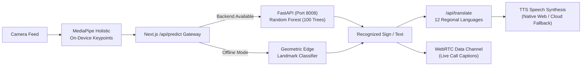

<div align="center">

# संकेतिका · Sanketika
### *Open-Source Assistive Technology Giving Every Voice a Way to Be Heard*

An open-source accessibility and spatial computing platform engineered for deaf, hard-of-hearing, non-verbal, and motor-impaired individuals. Combining real-time on-device sign recognition, 12-language regional translation, AAC communicator tiles, Emergency SOS telemetry, and gesture-captioned WebRTC video calling.

[](https://github.com/parthsingh1234-wq/Sanketika)
[](LICENSE)
[](https://nextjs.org/)
[](https://react.dev/)
[](https://www.python.org/)
[](https://fastapi.tiangolo.com/)
[](https://www.tensorflow.org/js)
[](https://www.w3.org/WAI/WCAG21/quickref/)
[](#privacy-by-design)

[How to Access](#-how-to-access-sanketika) • [Why Sanketika Matters](#-why-sanketika-matters) • [Key Features](#-key-features) • [Architecture](#-architecture) • [How to Use](#-how-to-use-the-product) • [Quick Start](#-quick-start) • [API Reference](#-api-reference) • [Model Training](#-training-custom-gestures--extending-models) • [Troubleshooting](#-troubleshooting)

</div>

---

> **संकेतिका (Sanketika)**: Sanskrit and Hindi for *a system of signs, indications, and accessible gestures*.  
> 📖 For technical architectural specifications, benchmark latencies, and edge ML pipelines, see [DOCUMENTATION.md](DOCUMENTATION.md).

---

## 📲 How to Access Sanketika

Sanketika is built to be accessible across multiple platforms and devices:

| Access Method | Platform | How to Access / Run |
| :--- | :--- | :--- |
| **🌐 Web Application** | Any device with a modern browser (PC, Mac, Linux, Tablet, Mobile) | Run locally on Port `3005` (`http://localhost:3005`) or deploy to any cloud host (Vercel, Render, Railway, AWS). |
| **📱 Android Mobile App** | Android phones and tablets | Download and install the pre-built **[GestureAI.apk](GestureAI.apk)** directly from this repository for on-the-go offline tracking. |
| **💻 Standalone Desktop GUI** | Windows, macOS, Linux | Run `python application.py` for a lightweight, offline OpenCV + MediaPipe desktop window ideal for classrooms and clinics. |
| **🔌 Open REST APIs** | Any programming language or third-party platform | Integrate real-time sign classification (`/api/predict`), regional translation (`/api/translate`), and Emergency SOS (`/api/emergency`) into your own apps or smart kiosks. |

---

## 📌 Why Sanketika Matters (The Open-Source Mission)

Over **430 million people worldwide** live with disabling hearing loss, and more than **70 million people** rely on sign language as their primary mother tongue. Yet, over 99% of hearing individuals—including doctors, emergency responders, bank tellers, and transit conductors—do not understand sign language.

Existing solutions suffer from three fundamental problems:
1. **The English Monoculture**: Almost all sign language AI tools only translate into English. In India and developing nations, millions of deaf individuals and their families speak Hindi, Tamil, Telugu, Marathi, Bengali, or Gujarati. Sanketika is the first platform translating sign language into **12 regional Indian and global languages** with native scripts and voice synthesis.
2. **Privacy Violations**: Many commercial systems upload raw camera video to remote cloud servers. For a deaf user, their hands and home are on camera. Sanketika guarantees **100% on-device edge landmark processing**—raw video never leaves your browser.
3. **Siloed Disabilities**: People with motor impairments, non-verbal conditions, or temporary speech trauma are often left behind. Sanketika combines sign translation, AAC communicator tiles, Wong-Baker clinical pain scales, and single-switch scanning into one cohesive platform.

---

## ✨ Key Features

### 1. Dual-Engine Sign Language Recognition
* **Zero-Latency Edge Inference**: Client-side MediaPipe Holistic and TensorFlow.js / TFLite pipeline processes 120 FPS landmark tracking directly within WebGL canvas memory. Raw camera frames are never transmitted over the network.
* **Dual Vocabulary Standard**: Full support for both **American Sign Language (ASL)** and **Indian Sign Language (ISL)** dictionaries.
* **Python FastAPI Server Pipeline (Port 8008)**: Scikit-Learn Random Forest ensemble (`ASL_model.p`, 100 estimators, 30 gesture classes) providing server-grade probability distributions, top predictions, and sub-10ms response latencies.
* **Dynamic Intelligent Edge Classifier**: If the Python server is offline, the Next.js edge route evaluates Euclidean landmark geometries (finger-to-wrist extension ratios, thumb angles, and planar vectors) dynamically, guaranteeing reliable recognition without static fallbacks.

### 2. Multi-Lingual Regional Translation (12 Languages)
Native-script rendering, Roman phonetic pronunciation guides, and localized speech synthesis across Indian and global languages:

| Region | Supported Languages | Native Script Example |
| :--- | :--- | :--- |
| **Northern & Western India** | Hindi, Marathi, Gujarati, Punjabi | हिन्दी (`नमस्ते`), मराठी (`नमस्कार`), ગુજરાતી (`નમસ્તે`), ਪੰਜਾਬੀ (`ਸਤਿ ਸ਼੍ਰੀ ਅਕਾਲ`) |
| **Southern India** | Tamil, Telugu, Kannada, Malayalam | தமிழ் (`வணக்கம்`), తెలుగు (`నమస్కారం`), ಕನ್ನಡ (`ನಮಸ್ಕಾರ`), മലയാളം (`നಮಸ್ಕಾರಂ`) |
| **Eastern India** | Bengali | বাংলা (`নমস্কার`) |
| **International** | English, Spanish, French | English (`Hello`), Español (`Hola`), Français (`Bonjour`) |

* **Cloud TTS Failover**: Automatic fallback to Google Neural TTS audio synthesis whenever a host browser or operating system lacks native regional voice engines.

### 3. Screen Reader & Non-Visual Accessibility
* **Acoustic Earcon Sonification**: Custom Web Audio harmonic cues for character entry, backspace deletion, buffer clearing, and mode switches.
* **Tactile Haptic Feedback**: `navigator.vibrate` patterns including rhythmic pulses and the international SOS distress sequence (`··· −−− ···`).
* **ARIA Live Regions**: Screen reader announcements with separate `polite` and `assertive` broadcast channels.
* **Visual Contrast & Dyslexia Customizer (`Alt + A`)**:
  * High-Contrast Yellow on Black (WCAG 2.1 AAA low-vision standard)
  * High-Contrast White on Black
  * Colorblind-safe palette (Wong 2011)
  * OpenDyslexic typography toggle
  * Text zoom scaling from 100% to 175%

### 4. Inclusive Digital Services Communicator & AAC
* 🚨 **Emergency SOS Beacon**: Instant audible alarm, browser GPS telemetry dispatch, and localized distress cards with live ETA tracking.
* 🏥 **Clinical Consultation**: Interactive Wong-Baker 0–10 Pain Rating Scale with visual facial representations and symptom selectors.
* 🚌 **Public Transit & Transport Cards**: Destination confirmation, seat reservation, and wheelchair-ramp assistance cards.
* 🏦 **Banking & Counter Services**: Dedicated deposit, withdrawal, and enquiry cards for public tellers.
* 🗣️ **Augmentative & Alternative Communication (AAC)**: 12-tile daily living board with single-switch scanning for severe motor impairments.
* 🖥️ **Teller Full-Screen View**: High-contrast, large-format visual presentation mode designed for service desk staff.

### 5. Accessible Peer-to-Peer Video Calling (`/call`)
* **Synchronized WebRTC Voice & Video**: Combines real-time gesture tracking with microphone audio tracks so remote peers receive voice audio alongside visual sign language interpretation.
* **Live Gesture Transcriptions**: Transmits recognized signs across the WebRTC data channel for instantaneous on-screen captions.
* **PeerJS Resilience**: Error listeners, connection status badges (`Connecting...` → `Ready for calls` → `Connected`), and one-click peer ID copying.

---

## 🏗️ Architecture



### Privacy by Design
Only normalized mathematical landmark coordinates (never raw video frames or camera streams) are transmitted to `/api/predict`. The entire computer vision pipeline runs locally inside your browser's WebGL context.

---

## 🧰 Technology Stack

| Layer | Technologies |
| :--- | :--- |
| **Frontend Web App** | Next.js 16 (App Router), React 19, TypeScript, Lucide Icons |
| **Edge Machine Learning** | MediaPipe Holistic, TensorFlow.js, TFLite (`model.tflite`, `isl_model.tflite`) |
| **Backend ML Service** | Python 3.13, FastAPI, Scikit-Learn (Random Forest), NumPy, Uvicorn |
| **Real-Time Communication** | WebRTC, PeerJS (Signalling & Data Channels) |
| **Sensory Accessibility** | Web Audio API (Earcons), Web Speech API, Capacitor TTS, Vibration API |
| **Desktop Application** | Python, CustomTkinter, OpenCV, MediaPipe |
| **Mobile Application** | Android APK (Capacitor Native Bridge) |

---

## 📖 How to Use the Product

### Scenario A: Real-Time Sign Translation (Live Engine)
1. Navigate to **`http://localhost:3005/live`** in your browser.
2. Grant camera permissions. The MediaPipe Holistic engine initializes on-device.
3. Switch between **ASL** (single-hand alphabet) and **ISL** (two-hand vocabulary) using the tabs or by pressing `Alt + M`.
4. Perform hand gestures. Recognized letters and phrases appear in the sentence builder.
5. Select any regional language (e.g. Hindi, Tamil, Spanish). Press `Alt + S` to speak the translation aloud.

### Scenario B: Conducting an Accessible Video Call
1. Open **`http://localhost:3005/call`**.
2. Click the **Copy** icon next to **"My ID"** in the navigation header and share your ID with your peer.
3. In the sidebar dialer, paste your peer's ID and click **"Call Peer"**.
4. Both peers will see live video, hear microphone voice audio, and see sign gestures transcribed as real-time captions in the chat transcript.

### Scenario C: Public Services & Hospital Consultation
1. On the Live Engine page, select the **Services** mode tab.
2. Choose from categories: **Emergency**, **Hospital (Wong-Baker Pain Scale)**, **Transport**, **Banking**, or **AAC Needs**.
3. Tap any tile (or use single-switch spacebar scanning) to speak the phrase in the regional language and present a high-contrast card to service counter staff.

### Scenario D: Sensory & Visual Accessibility Customizer
1. Press `Alt + A` or click the **Eye icon** in the top navigation bar.
2. Toggle high-contrast themes (Yellow on Black / White on Black), enable OpenDyslexic typography, adjust text zoom scaling, or toggle audio earcons and haptic vibrations.

---

## 🚀 Quick Start (Local Setup)

### Prerequisites
- **Node.js**: v20 or higher
- **Python**: 3.10 – 3.13 with `pip`
- Modern web browser (Chrome, Edge, Firefox, or Safari) with camera and mic permissions

### 1. Launch the Python ML Backend (Port 8008)
```bash
# In the project root directory
python backend_server.py
```
*The service starts on `http://127.0.0.1:8008` and automatically loads the Scikit-Learn `ASL_model.p` model.*

### 2. Launch the Next.js Web App (Port 3005)
```bash
cd web-app
npm install
npm run dev
```
*Open your browser and navigate to **`http://localhost:3005`**.*

> **Why Port 3005?** Port `3005` is configured explicitly in `package.json` so Sanketika runs without port conflicts on machines where Port `3000` is reserved by other local applications (such as Open WebUI).

### 3. (Optional) Run the Desktop Application
```bash
python application.py
```

### 4. (Optional) Install the Mobile APK
Transfer **[GestureAI.apk](GestureAI.apk)** to an Android smartphone and tap to install for mobile testing.

---

## 🔑 Environment Variables

Sanketika works out-of-the-box with sensible defaults, but can be configured via environment variables. Copy `.env.example` to `.env.local` inside `web-app/` or to `.env` in the root directory:

```bash
cp .env.example .env
cp web-app/.env.example web-app/.env.local
```

| Variable | Scope | Default Value | Description |
| :--- | :--- | :--- | :--- |
| `PORT` | Next.js Frontend | `3005` | Local HTTP port for the web interface and API proxy routes |
| `BACKEND_URL` | Next.js Frontend | `http://127.0.0.1:8008` | Upstream URL to the Python FastAPI ML backend service |
| `BACKEND_PORT` | Python Backend | `8008` | Local port binding for `backend_server.py` |
| `BACKEND_HOST` | Python Backend | `127.0.0.1` | Network interface binding host for Uvicorn |
| `NODE_ENV` | Next.js Frontend | `development` | Application runtime environment (`development` / `production`) |

---

## 🌐 Network Ports Configuration

| Service | Host & Port | Description |
| :--- | :--- | :--- |
| **Next.js Web Application** | `http://localhost:3005` | Main frontend interface, live engine, calls, and API routes |
| **Python FastAPI ML Backend** | `http://127.0.0.1:8008` | Random Forest ML inference, translation lookup, and SOS dispatcher |

---

## 📁 Repository Structure

```
Sanketika/
├── .env.example            # Environment variables configuration template
├── backend_server.py       # Python FastAPI ML & accessibility service (Port 8008)
├── application.py          # Desktop CustomTkinter GUI viewer
├── realtime_detection.py   # Desktop OpenCV + MediaPipe ASL pipeline
├── ASL_model.p             # Trained Random Forest ensemble (16.3 MB)
├── signs.json              # Gesture dictionary mappings
├── GestureAI.apk           # Pre-built Android package for mobile deployment
├── sample_data/            # Sample inputs & test payloads for API validation
│   ├── sample_landmarks_asl.json # Sample 42-element ASL gesture coordinates
│   ├── sample_emergency_sos.json # Sample GPS telemetry and pain rating payload
│   ├── sample_translation.json   # Sample regional language translation query
│   └── README.md           # Instructions for cURL & Postman validation
├── collect_images.py       # Dataset collection script for new gestures
├── create_dataset.py       # Landmark extraction script (generates pickle data)
├── train_classifier.py     # Random Forest model training script
├── train_isl.py            # ISL neural network training script
├── DOCUMENTATION.md        # Full technical specifications & mathematical formulations
├── LICENSE                 # MIT Open Source License
└── web-app/                # Next.js 16 + React 19 Frontend Web Application
    ├── src/
    │   ├── app/            # Routes: /, /live, /call, /about, /motives, /privacy, /terms
    │   │   └── api/        # Endpoints: /health, /predict, /emergency, /translate, /signs, /routes
    │   ├── components/     # UI: DetectorEngine, InclusiveServicesPanel, Modal, Navigation
    │   ├── utils/          # Regional languages, TTS, sonification, backend client
    │   └── __tests__/      # Automated Node.js test suites (21 test suites)
    ├── public/             # MediaPipe WASM runtime, TFLite models (model.tflite, isl_model.tflite)
    └── package.json        # Dependencies and scripts (Configured on Port 3005)
```

---

## 📡 API Reference

| Endpoint | Method | Payload / Parameters | Description |
| :--- | :--- | :--- | :--- |
| `/health` or `/api/health` | `GET` | None | System status, model load state, active classes, engine type |
| `/api/predict` | `POST` | `{ landmarks: number[], mode: "asl" }` | Predicts sign character, confidence, top alternatives, and latency |
| `/api/emergency` | `POST` | `{ latitude, longitude, painLevel, userNote }` | Logs SOS distress telemetry and returns incident ID and response ETA |
| `/api/translate` | `POST` | `{ text: string, targetLang: string }` | Returns translated text, phonetic guides, and BCP-47 locale |
| `/api/signs` | `GET` | None | Returns supported ASL letters, control gestures, and ISL catalog |
| `/api/routes` | `GET` | None | Returns registered navigation routes across the platform |

#### Health Check Verification
```bash
curl http://127.0.0.1:8008/health
curl http://localhost:3005/api/health
```

---

## 🔬 Training Custom Gestures & Extending Models

Developers and researchers can train new signs using the included dataset pipelines:

1. **Collect Images**:
   ```bash
   python collect_images.py
   ```
2. **Extract Landmark Coordinates**:
   ```bash
   python create_dataset.py
   ```
3. **Train Random Forest Classifier**:
   ```bash
   python train_classifier.py
   ```
4. **Export Model to Web**:
   ```bash
   python export_model.py
   ```

---

## ⌨️ Keyboard Shortcuts

| Shortcut | Action |
| :--- | :--- |
| `Alt + S` | Speak active sentence aloud in the selected regional language |
| `Alt + C` | Clear current sentence builder and canvas buffer |
| `Alt + M` | Cycle detection modes: ASL ↔ ISL ↔ Custom ↔ Services |
| `Alt + E` | Dispatch Emergency SOS telemetry alert |
| `Alt + A` | Open Accessibility & Sensory Settings Modal |
| `Space` | Start / Pause video detection engine |

---

## 🧪 Testing & Validation

Run the automated Node.js test suite (21 unit tests covering localizations, sonification, services, and backend integration):
```bash
cd web-app
npm test
```

Build the production bundle:
```bash
cd web-app
npm run build
```

---

## 🛠️ Troubleshooting

| Symptom | Cause | Resolution |
| :--- | :--- | :--- |
| **Another app appears on `localhost:3000`** | Another process (e.g. Open WebUI) is using port 3000. | Access Sanketika directly on port 3005: **`http://localhost:3005`**. |
| **`ModuleNotFoundError: No module named 'mediapipe'`** | Missing Python packages in your active environment. | Run: `pip install mediapipe customtkinter`. |
| **Desktop app shows camera unavailable** | Camera 0 is occupied by another app (Zoom, Teams). | Close background camera applications and relaunch `application.py`. |
| **Predictions appear generic / edge mode active** | Python FastAPI server on port 8008 is not running. | Run `python backend_server.py` in a terminal window. |
| **No audio for selected regional language** | OS lacks native speech synthesis voice packs. | Cloud TTS fallback will stream audio automatically via Google TTS; check your internet connection. |
| **Garbled Indic characters in Windows terminal** | Default Windows console encoding is not UTF-8. | Run `chcp 65001` before executing terminal commands. |

---

## 🗺️ Roadmap

- [ ] Continuous (non-isolated) dynamic sign sentence tracking
- [ ] Offline-first Progressive Web App (PWA) packaging with service worker caching
- [ ] Direct BLE integration with wearable haptic armbands
- [ ] Expanded ISL vocabulary (100+ public service phrases)
- [ ] Web-based custom gesture recording and transfer learning studio

---

## 🤝 Contributing

Contributions are warmly welcomed, particularly from deaf, hard-of-hearing, and accessibility specialists:
1. Fork the repository and create your feature branch (`git checkout -b feature/accessible-enhancement`).
2. Verify tests pass: `npm test` and `npm run build`.
3. Open a Pull Request detailing the accessibility impact of your contribution.

---

## 📄 License

This project is open-source under the **[MIT License](LICENSE)**.

---

## 🙏 Acknowledgments

Built with gratitude for the foundational work of:
- **MediaPipe Holistic** & **TensorFlow.js** teams at Google
- **Scikit-Learn** & **FastAPI** open-source maintainers
- **OpenDyslexic** typography initiative
- **Wong (2011)** colorblind-safe palette standards
- **Wong-Baker FACES®** Foundation for pain rating scales

<div align="center">

**Built so that no voice is ever left unheard.**

</div>
